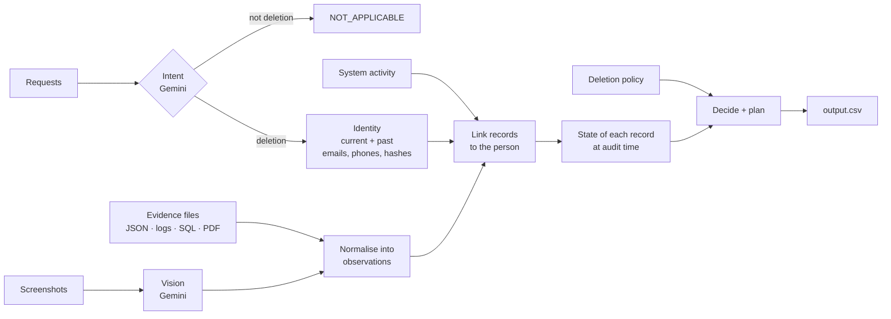

# Ghost Data Audit Agent

An AI-assisted agent that checks whether a "deleted" customer is really gone.

Companies report GDPR-style deletion requests as **Complete** while personal data survives in
database replicas, backups, search indexes, support attachments, exports and logs, and sync jobs
quietly copy it back. Given a company's systems evidence, this agent decides for each deletion
request whether the deletion is truly complete. If it is not, it lists every surviving copy and
writes an ordered plan to fix it, with the checks that prove the fix.

Built for **HackerRank Orchestrate (October 2026)**, challenge *Ghost Data Still Exists*.

## Results

| | |
|---|---|
| Deletion status accuracy (32 labelled cases) | **100%** |
| Step precision / recall / F1 | **99.5% / 94.3% / 96.8%** |
| Requests audited | 518 in 6 languages |
| False "Complete" claims caught | **165 of 254** requests the company reported as complete |
| LLM calls for the full run | **7** (~92 tokens per request, $0 on the free tier) |
| Runtime with cached model answers | ~10 seconds, byte-identical output on every run |

Full evaluation with failure analysis: [`code/evaluation/evaluation_report.md`](code/evaluation/evaluation_report.md).
Model usage and cost: [`code/evaluation/usage_report.md`](code/evaluation/usage_report.md).

## The problem

Each request has the requester's email (possibly an old one), the deletion workflow's claimed
status, and an audit time. The agent has:

- the identity history of every user (emails, phones and hashes change over time);
- 4,011 system activity events (deletes, syncs, exports, restores…) mixing all customers;
- 94 evidence files in six formats: JSON, logs in six syntaxes, SQLite dumps with replicas,
  PDFs, text records and app screenshots;
- a deletion policy: delete, redact, anonymize or retain each data category.

For each request it must output one of `COMPLETE`, `INCOMPLETE` or `NOT_APPLICABLE` (not a
deletion request), plus ordered steps such as:

```json
[
  {"step_no":1,"phase":"FINDING","system_id":"export_service","resource_id":"export_1842",
   "operation":"REPORT_REMAINING_RECORD","state":"PRESENT","evidence_id":"evidence_18"},
  {"step_no":2,"phase":"REMEDIATION","system_id":"export_service","resource_id":"export_1842",
   "operation":"DELETE_RECORD","state":"ABSENT","evidence_id":""},
  {"step_no":3,"phase":"VERIFICATION","system_id":"export_service","resource_id":"export_1842",
   "operation":"VERIFY_RECORD_ABSENT","state":"ABSENT","evidence_id":""}
]
```

The data is designed to mislead. Workflow results report `SUCCESS` when they failed. Several
customers share a name. Decoy records point at real users. Evidence captured after the audit
must be ignored.

## How it works

The design keeps the LLM small and the logic deterministic. The model is used only where code
can't do the job: understanding request intent in six languages, and reading screenshots.
Everything else is plain Python and can be audited.



| Stage | Module | What it does |
|---|---|---|
| Load | [`loaders.py`](code/loaders.py) | Typed, validated records; all timestamps in UTC |
| Identity | [`identity.py`](code/identity.py) | Resolves the request email (current or historical) to every identifier the person held up to the audit time |
| Evidence | [`evidence.py`](code/evidence.py) | Parses every format into one model: *record R in system S was in state X at time T, still exposing identifiers E*, plus which files list a whole system |
| State | [`state.py`](code/state.py) | Links records to the person and reconstructs each record's real state at the audit time |
| Policy | [`policy.py`](code/policy.py) | Maps each record's category to its rule, builds the findings, remediation and verification steps, and orders them |
| LLM | [`intent.py`](code/intent.py), [`vision.py`](code/vision.py), [`llm.py`](code/llm.py) | Gemini with JSON schemas, batching, a disk cache and a daily request budget |
| Evaluation | [`code/evaluation/`](code/evaluation/) | Scorer, metamorphic test cases, reports |

## Engineering decisions

- **Claims are not proof.** A workflow's `COMPLETE` or an activity's `SUCCESS` never decides a
  record's state. Only evidence does. A copy surviving in a failover replica counts as present
  even when the primary deleted it.
- **Strict time cutoff.** Each case is judged only on evidence captured by its own audit time.
  A metamorphic test moves the audit one minute before a key file and checks that the file is
  no longer used.
- **Linking without identifiers.** Deleted accounts and anonymized records carry no email. The
  agent links them by matching the deletion worker's activity timing and reported result
  against all requests as a single global one-to-one assignment. It also follows internal user
  IDs, record references, log trace IDs and data-catalog aliases. Names are never trusted on
  their own, because the data contains same-name decoys.
- **Prefer omission to guessing.** When two requests audited at the same moment compete for an
  anonymous record, the agent leaves it out. Guessing raised recall slightly but lowered
  precision more.
- **Remediation order matters.** Sync connectors are disabled and backup restores blocked before
  records are deleted, so the data can't be copied back.
- **LLM cost engineering.** 518 requests contain 398 distinct texts. Classifying 100 per call,
  reading 4 screenshots per call, using JSON schemas and low thinking cut a full run from ~27
  calls to 7. Answers are cached by model, prompt and image hash. If the model is unavailable,
  the pipeline still produces a valid output.

## Run it

The challenge dataset belongs to HackerRank and is not included in this repository. With access
to it, place the files in `dataset/` (`deletion_requests.csv`, `user_identities.csv`,
`user_audit_log.csv`, `system_activity.csv`, `deletion_rules.csv`, `evidence_files.csv`,
`sample_*.csv` and the `evidence/` folder).

```bash
python3 -m venv .venv && source .venv/bin/activate    # Windows: .venv\Scripts\activate
pip install -r code/requirements.txt

python code/main.py                       # audit all requests -> output.csv
python code/main.py --samples             # audit the 32 labelled samples
python code/evaluation/main.py --details  # score them against the answer key
python code/evaluation/custom_cases.py    # metamorphic test cases
```

No API key is needed to reproduce the results: the model answers are cached in
`code/cache/llm_responses.json`. To call Gemini for new inputs, copy `.env.example` to `.env`
and set `GEMINI_API_KEY`.

| Environment variable | Default | Purpose |
|---|---|---|
| `GEMINI_API_KEY` | none | Only needed for uncached inputs |
| `GEMINI_MODEL` | `gemini-3.5-flash` | Model for intent and screenshots |
| `LLM_DAILY_BUDGET` | `18` | Max API requests per quota day (free tier: 20) |
| `LLM_PARALLEL_CALLS` | `1` | Concurrent model calls |

## Project layout

```text
code/
├── main.py              entry point
├── loaders.py           dataset loading and validation
├── identity.py          identity resolution over time
├── evidence.py          evidence parsers (JSON, logs, SQL, PDF, screenshots)
├── state.py             record linking and state reconstruction
├── policy.py            policy rules, step building and ordering
├── intent.py            request intent classification (LLM)
├── vision.py            screenshot extraction (LLM)
├── llm.py               Gemini client: cache, retries, daily budget, usage
├── cache/               cached model answers
└── evaluation/          scorer, custom cases, reports, sample predictions
output.csv               the agent's answers for all 518 requests
```

**Stack:** Python 3.12, Google Gemini (`google-genai`), SQLite, `pypdf`.
